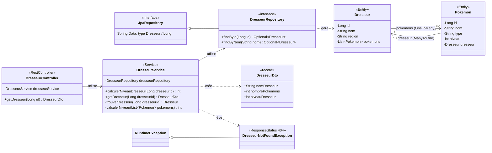
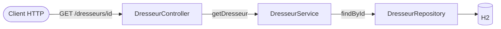
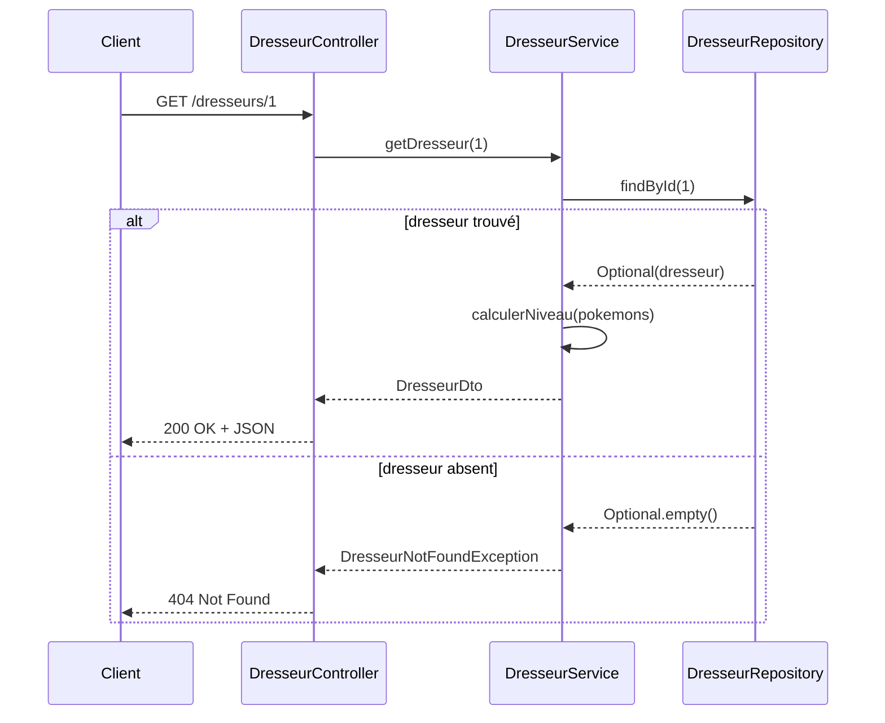
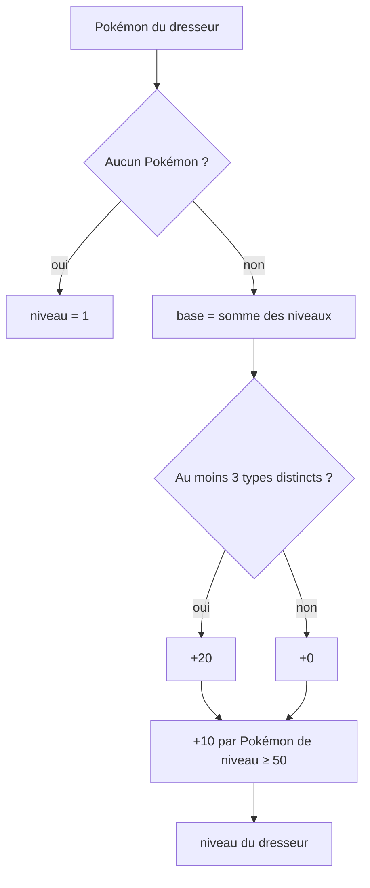

# Pokémon Management API

Microservice Spring Boot du SI de la Ligue Pokémon. Il expose le profil d'un dresseur et calcule son niveau à partir de ses Pokémon. L'objet de l'évaluation est la **suite de tests** sur les 3 couches (Repository, Service, Controller), chaque couche testée isolément, en structure Arrange / Act / Assert.

## Stack

| Élément | Version / outil |
|---|---|
| Langage | Java 17 minimum (compilé et testé avec un JDK 27) |
| Framework | Spring Boot 4.1.2 (Web MVC, Data JPA) |
| Base de données | H2 en mémoire |
| Build | Maven, via le wrapper `mvnw` |
| Tests | JUnit 5, Mockito, MockMvc (`spring-boot-starter-test`, `-webmvc-test`, `-data-jpa-test`) |

## Lancer le projet

```bash
./mvnw install          # compile et lance les 20 tests
./mvnw spring-boot:run  # démarre l'API sur http://localhost:8080
```

Au lancement normal, la base est vide : le jeu de données `data.sql` ne sert qu'aux tests.

> **Spring Boot 4.** Les annotations de test ont changé de module et de package par rapport à Spring Boot 3. `@DataJpaTest` est dans `org.springframework.boot.data.jpa.test.autoconfigure` (starter `spring-boot-starter-data-jpa-test`). `@WebMvcTest` est dans `org.springframework.boot.webmvc.test.autoconfigure` (starter `spring-boot-starter-webmvc-test`).

## Diagramme de classes



**Relation JPA.** La relation est bidirectionnelle. Côté base, c'est `Pokemon` qui porte la clé étrangère `dresseur_id` (`@ManyToOne`). `Dresseur.pokemons` est le côté inverse (`@OneToMany(mappedBy = "dresseur")`). Le sujet écrit « @One » côté Pokémon : c'est forcément `@ManyToOne`.

**Pourquoi un DTO.** Le controller ne renvoie jamais l'entité. Sérialiser `Dresseur` en JSON boucle à l'infini (Dresseur → Pokemon → Dresseur…) et exposerait le modèle de persistance. Le `DresseurDto` ne contient que les trois champs demandés.

## Architecture en couches



| Couche | Classe | Responsabilité | Ce qui est testé, et comment |
|---|---|---|---|
| Controller | `DresseurController` | Exposer l'endpoint REST, sérialiser le DTO | Statuts HTTP et JSON, service mocké (`@WebMvcTest`) |
| Service | `DresseurService` | Règle métier, existence du dresseur, construction du DTO | Calcul du niveau, repository mocké (Mockito) |
| Repository | `DresseurRepository` | Accès aux données (Spring Data JPA) | Requêtes et relation, sur une vraie base H2 (`@DataJpaTest`) |

## Endpoint

### `GET /dresseurs/{id}`



| Cas | Statut | Corps |
|---|---|---|
| Le dresseur existe | `200 OK` | `{"nomDresseur": "Sacha", "nombrePokemons": 3, "niveauDresseur": 160}` |
| Le dresseur n'existe pas | `404 Not Found` | Réponse d'erreur par défaut de Spring Boot |

## Règle métier : niveau du dresseur

Implémentée dans `DresseurService.calculerNiveauDresseur(Long dresseurId)`.



**Exemples :**

| Pokémon (type, niveau) | Somme | Diversité | Élite | Niveau |
|---|---|---|---|---|
| aucun | — | — | — | **1** |
| Feu 10, Eau 20 | 30 | 0 (2 types) | 0 | **30** |
| Feu 10, Eau 20, Électrik 30 | 60 | +20 | 0 | **80** |
| Feu 49 | 49 | 0 | 0 (49 < 50) | **49** |
| Feu 50 | 50 | 0 | +10 | **60** |
| Feu 50, Eau 60, Électrik 10 | 120 | +20 | +20 | **160** |

## Choix d'implémentation

| Point | Choix | Justification |
|---|---|---|
| Dresseur introuvable | **404 Not Found** (le sujet indique 201) | 201 signifie *Created*, ce qui ne correspond pas au cas. Choix validé par l'enseignant. |
| Types distincts | Comparaison exacte des chaînes | `"Feu"` et `"feu"` comptent comme deux types. Le sujet ne demande pas de normalisation. |
| Seuil élite | `niveau >= 50`, inclusif | Le sujet écrit « ≥ 50 ». Le cas limite 50 et le cas 49 sont testés tous les deux. |
| Bonus élite | +10 **par** Pokémon élite | « Chaque Pokémon de niveau ≥ 50 apporte +10 ». Testé avec deux élites. |
| Accès aux Pokémon | `dresseurRepository.findById(id)` puis `dresseur.getPokemons()` | Un seul repository à mocker, ce qui garde les tests du service simples. Le service est `@Transactional(readOnly = true)` pour que le chargement paresseux de la collection fonctionne. |
| Assertions | `assertEquals` (JUnit) | C'est l'outil cité explicitement dans le sujet. |
| Mock Spring | `@MockitoBean` | Remplace `@MockBean`, déprécié en Spring Boot 3.4 puis supprimé en Spring Boot 4. |
| Jeu de données | Ids laissés à l'auto-incrément dans `data.sql` | Des ids explicites ne font pas avancer la séquence IDENTITY de H2 : un `save()` dans un test entrerait alors en conflit de clé primaire. |

## Suite de tests

Conventions appliquées à tous les tests :
- nom au format `should_[comportement_attendu]_when_[condition]()` ;
- corps découpé en trois blocs `// Arrange`, `// Act`, `// Assert`.

### Repository : `DresseurRepositoryTest` (7 tests)

`@DataJpaTest` sur une base H2. Le jeu de données vient de `src/test/resources/data.sql`. Chaque test s'exécute dans une transaction annulée à la fin, donc les tests ne s'influencent pas.

| Dresseur | Région | Pokémon |
|---|---|---|
| Sacha | Kanto | Dracaufeu (Feu 55), Tortank (Eau 40), Pikachu (Électrik 30) |
| Ondine | Kanto | Staross (Eau 35), Psykokwak (Eau 20) |
| Novice | Johto | aucun |

| Test | Vérifie |
|---|---|
| `should_find_dresseur_when_nom_exists` | `findByNom` retrouve Sacha et sa région |
| `should_return_empty_when_nom_does_not_exist` | `findByNom` renvoie un `Optional` vide |
| `should_find_dresseur_when_id_exists` | `findById` retrouve Ondine |
| `should_return_empty_when_id_does_not_exist` | `findById(999)` renvoie un `Optional` vide |
| `should_load_pokemons_when_dresseur_has_pokemons` | La relation `@OneToMany` charge les 3 Pokémon de Sacha |
| `should_return_no_pokemon_when_dresseur_has_none` | Novice n'a aucun Pokémon |
| `should_persist_dresseur_when_saved` | `save` attribue un id, et la table passe à 4 dresseurs |

### Service : `DresseurServiceTest` (10 tests)

Isolation totale : `@ExtendWith(MockitoExtension.class)`, aucun contexte Spring. Le repository est un `@Mock` dont les retours sont simulés par `when(...).thenReturn(...)`.

| Test | Cas couvert |
|---|---|
| `should_return_1_when_dresseur_has_no_pokemon` | Cas limite : 0 Pokémon |
| `should_return_sum_of_levels_when_no_bonus_applies` | Cas nominal, sans bonus |
| `should_apply_diversity_bonus_when_dresseur_has_3_different_types` | Bonus diversité |
| `should_not_apply_diversity_bonus_when_dresseur_has_only_2_types` | Limite du bonus diversité |
| `should_apply_elite_bonus_when_pokemon_level_is_exactly_50` | Limite basse du bonus élite |
| `should_not_apply_elite_bonus_when_pokemon_level_is_49` | Juste sous le seuil élite |
| `should_apply_elite_bonus_per_pokemon_when_several_are_elite` | Bonus élite compté par Pokémon |
| `should_cumulate_all_bonuses_when_diversity_and_elite_conditions_met` | Cumul des bonus (160) |
| `should_throw_exception_when_dresseur_does_not_exist` | Dresseur absent : `DresseurNotFoundException` |
| `should_build_dto_when_dresseur_exists` | Construction du `DresseurDto` |

### Controller : `DresseurControllerTest` (2 tests)

`@WebMvcTest(DresseurController.class)` ne charge que la couche web. Le service est remplacé par un `@MockitoBean`, et les requêtes sont simulées avec `MockMvc`.

| Test | Vérifie |
|---|---|
| `should_return_200_and_dto_when_dresseur_exists` | Statut 200, puis les 3 champs JSON via `jsonPath` |
| `should_return_404_when_dresseur_does_not_exist` | Statut 404 quand le service lève l'exception |

### Test de démarrage : `PokemonManagementApitpApplicationTests` (1 test)

`contextLoads()` est le test généré par Spring Initializr. `@SpringBootTest` charge le contexte complet de l'application et échoue si un bean est mal configuré. Il ne fait pas partie des tests demandés par couche.

## Arborescence

```
PokemonManagementAPITP/
├── pom.xml
├── mvnw, mvnw.cmd
├── src/main/java/com/example/pokemonmanagementapitp/
│   ├── PokemonManagementApitpApplication.java
│   ├── controller/DresseurController.java
│   ├── dto/DresseurDto.java
│   ├── model/Dresseur.java
│   ├── model/Pokemon.java
│   ├── repository/DresseurRepository.java
│   └── service/
│       ├── DresseurService.java
│       └── DresseurNotFoundException.java
├── src/main/resources/application.properties
└── src/test/
    ├── java/com/example/pokemonmanagementapitp/
    │   ├── PokemonManagementApitpApplicationTests.java
    │   ├── controller/DresseurControllerTest.java
    │   ├── repository/DresseurRepositoryTest.java
    │   └── service/DresseurServiceTest.java
    └── resources/
        ├── application.properties   # defer-datasource-initialization
        └── data.sql                 # jeu de données des tests repository
```
